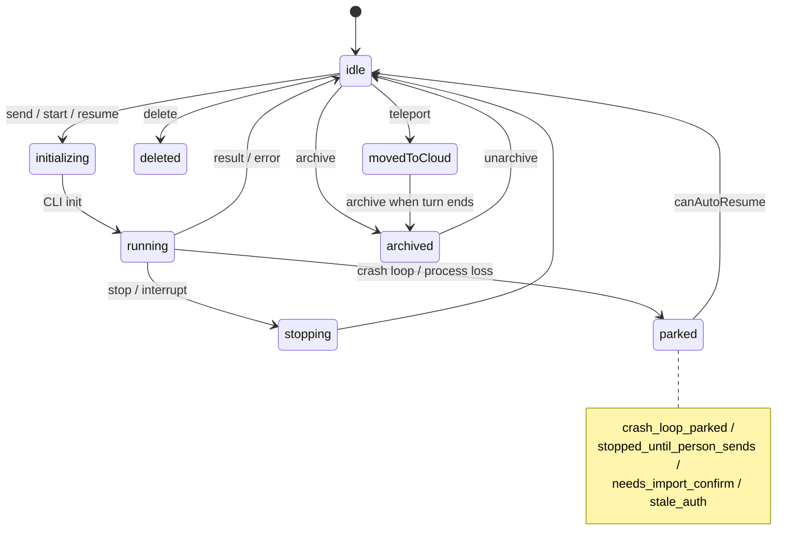
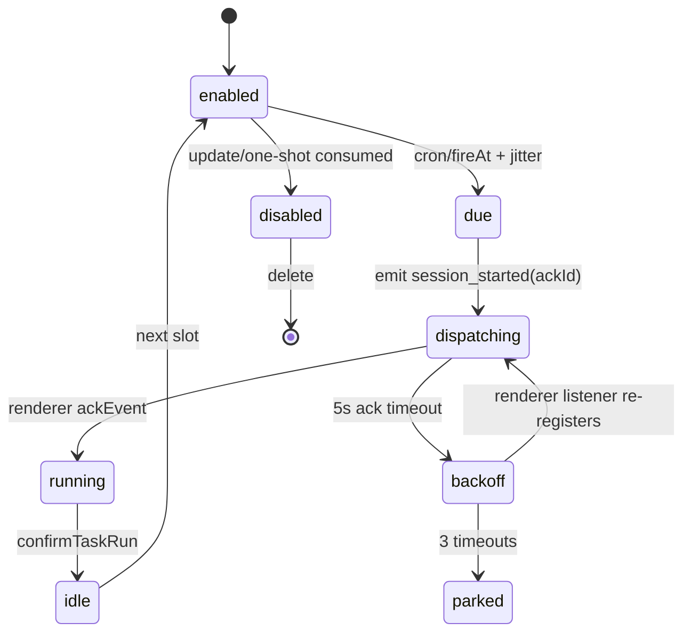

# Claude Desktop 2.42304.0 会话 / Agent 编排亮点

> 只读研究。对象：`/home/tars/yysapp/claude-desktop/app`（解包后的 Electron 应用）。
> 证据：`/home/tars/yysapp/claude-desktop/asset/ipc_services.json`、`/home/tars/yysapp/claude-desktop/asset/rea_summary.json`、`/home/tars/yysapp/claude-desktop/asset/rea_application_graph.json`，以及 `.vite/build` 下的压缩 bundle。
> 标记：**[已证实]** 指在 bundle/证据文件中直接读到实现或常量；**[推断]** 指由相邻代码、命名和调用关系推出；**[未知]** 指证据不足。
> bundle 是单行压缩文件；文中“偏移”是字符偏移，便于复核，不表示源码行号。

---

## 1. 结论速览（按“可借鉴价值”排序）

| 排名 | 亮点 | 一句话结论 | 评级 |
|---|---|---|---|
| 1 | **多层父子会话编排** | Cowork 主会话可用 `start_task` / `start_code_task` / `send_message` / `read_transcript` 派生子会话；Code 侧另有 side session、fork、subagent worktree；子会话空闲后自动回注结果通知。不是“一个大循环”，而是有明确父子边、任务边界和通知协议的会话图。 | S |
| 2 | **Turn 级持久输入状态机** | 每个 turn 以 `userMessageUuid` 为主线，区分 queued/started/completed，保存 held/kept/deferred sends；进程崩溃、重启、换账号后仍尽量不丢用户已输入内容。 | S |
| 3 | **上下文自动恢复（auto-compact + 续跑）** | 检测 context full 后自动发送 `/compact`，成功后再发送“请从断点继续”的续跑消息；失败有状态、原因和遥测，而不是直接把错误抛给用户。 | S |
| 4 | **Worktree 池 + 租约 + kept-dirty** | worktree 不是“用完即删”的临时目录，而是有 `leasedBy`、池化、复用、清理、脏树保留、分支切换 WIP 提交与 stash OID 校验的完整生命周期。 | S |
| 5 | **定时任务的分发确认（ack）协议** | 主进程调度器发出 `session_started` 后等待 renderer 在 5 秒内 `ackEvent`；启用 ack 模式时，未 ack 不消耗 cron slot，3 次超时后停泊，renderer 重新注册后重试。这是“至少一次”而不是“发完就算”。 | S |
| 6 | **会话控制记录与 CLI transcript 分离** | 控制记录（Desktop 用 JSON；AutoAgent 可映射为 SQLite）保存 UI 状态、权限、worktree、父子和调度信息；真正的对话内容仍由 Claude Code `.jsonl` transcript 承载。fork/rewind/pre-clear/import 都围绕这两层的一致性设计。 | A+ |
| 7 | **分层信任与授权继承** | cwd 信任、SSH endpoint-keyed 信任、per-session 目录授权、调度任务 per-task 权限、dispatch 子会话继承 approved tools / Chrome / Computer Use 授权。 | A+ |
| 8 | **可见性驱动的 warm / idle / prewarm** | 隐藏 15 分钟后空闲回收；重新可见时预热；预热有 1 秒错峰；另有隐藏 spare 进程池可被普通本地会话认领。 | A |
| 9 | **Transcript 搜索 worker** | 独立 utility worker，4 路并发扫描，处理 `compact_boundary`，50 MiB（52,428,800 字节）上限，`O_NOFOLLOW`/`O_NONBLOCK` 安全打开，最多抽取 10 万个 inference log id。 | A |
| 10 | **EngineSurface 声明式 UI 总线** | CLI/engine 通过 `uiRender`、`uiPress`、`uiPanes`、`uiHostAsked/uiHostAnswer` 驱动宿主渲染，带 client 路由、4 秒 host-ask 超时和 pane/focus/scroll 协议。 | B+ |

补充判断：

- **[已证实]** `ipc_services.json` 中 `LocalSessions` 339 个方法、`LocalAgentModeSessions` 128 个、`EngineSurface` 25 个、`CCDScheduledTasks` 13 个、`CoworkScheduledTasks` 18 个、`RemoteControlServing` 9 个、`SessionPopouts` 4 个、`Launch` 108 个、`CoworkSpaces` 34 个；共 93 个 IPC service、1329 个方法。
- **[已证实]** 图证据显示 1491 个 IPC operation、59 个 endpoint、92 个 ipc-channel、15 个 BrowserWindow；但 `coverage.status = "partial"`，因此数量应视为下界。
- **[已证实]** 按精确字符串搜索，bundle 中**没有** `agent registry`、`persistent child` 这两个字符串；`swarm` 只作为 `warm` 的子串出现（如 `warmCache`、`downloadVM`），没有独立的 swarm 子系统。因此本文不主张存在名为 “agent registry / persistent child / swarm” 的机制。
- **[已证实]** `checkpoint` 在 Desktop 的会话编排代码中主要指 **SSH 远程进程收养的重放检查点**（`{seq, skipBytes}`、`replayCheckpoint`、`sshReattach.checkpoint`）；另有 CLI 侧的 `fileCheckpointingEnabled`（为 `/rewind` 做文件快照）。它不是通用的“对话 checkpoint”。对话侧的等价物是 transcript fork point / rewind marker。

---

## 2. 数据模型与状态机

### 2.1 实体分层

```
┌─────────────────────────────────────────────────────────────────────┐
│ SessionRecord（Desktop 用 JSON；AutoAgent 可映射为 SQLite）           │
│  sessionId(local_*), cliSessionId, cwd/originCwd, backend(local/ssh/│
│  wsl), model, permissionMode, worktree*, parent/child*, grants*,     │
│  scheduledTaskId, contextRecovery, isArchived, movedToCloud ...      │
└───────────────┬───────────────────────────────┬─────────────────────┘
                │ 1:1（可多代）                    │ 1:N
                ▼                                 ▼
┌───────────────────────────────┐   ┌─────────────────────────────────┐
│ CLI transcript（Claude Code） │   │ Turn / pendingCycle             │
│ <cliSessionId>.jsonl          │   │  userMessageUuid, startedAt,    │
│ uuid / parentUuid / msg_*     │   │  inputOrigin, compacting,       │
│ compact_boundary / fork point │   │  bufferedBefore, promptUuids ...│
└───────────────────────────────┘   └──────────────┬──────────────────┘
                                                    │
                                                    ▼
                                       ┌───────────────────────────────┐
                                       │ messageBuffer / transcript    │
                                       │  user/assistant/system/result │
                                       │  uuid, parent_tool_use_id     │
                                       └───────────────────────────────┘

旁路实体：
  WorktreeLease(path, name, branch, sourceBranch, leasedBy, cliBound, status, keptDirty)
  PermissionGrant(scope: session/cwd/endpoint/tool; provenance; approvedAt)
  ScheduledTask(id, cron/fireAt, place, watcher, approvedPermissions, dispatchSubscribed...)
  DispatchChild(parentSessionId, childSessionId, kind=code|dispatch_child, notify state)
  PopoutLayout(sessionId, paneTileId/projectId, bounds, alwaysOnTop)
```

### 2.2 SessionRecord 的主要字段（分组）

**[已证实]** 持久化序列化函数是 `c1MnZbIW` 中的 `MA(e)`（偏移 578447）。字段非常多，按职责分组：

| 组 | 字段（节选） |
|---|---|
| 身份与路由 | `sessionId`, `cliSessionId`, `priorCliSessionIds`, `priorRemoteCliSessionIds`, `historyOnlyCliSessionId`, `preClearCliSessionId`, `unarchivedCliSessionId`, `bridgeSessionIds`, `cloudSessionId`, `remoteControlSpawn`, `remoteControlDescendant` |
| 工作目录与 Git | `cwd`, `originCwd`, `worktreePath`, `worktreeName`, `folderWorktrees`, `requestedAdditionalFolders`, `worktreeLazy`, `worktreePinned`, `gitAnchors`, `sourceBranch`, `branch`, `writtenBranches`, `prs` |
| 模型与推理 | `model`, `effort`, `effortInherited`, `sessionSettings`, `agent`, `permissionMode` |
| 会话生命周期 | `isArchived`, `title`, `titleSource`, `previousTitles`, `createdAt`, `lastActivityAt`, `lastFocusedAt`, `isStarred`, `movedToCloud`, `keptDirtyWorktree`, `keptDirtyAt`, `autoArchiveExempt` |
| 父子/调度 | `scheduledTaskId`, `spaceId`, `dispatchParentId`, `dispatchParentOrigin`, `forkedFromSessionId`, `forkedAtMessageUuid`, `lineageDetached`, `spawnedFrom`, `spawnedFromEndNotified`, `lastTurnReport`, `sideSessionReportOwed`, `sideSessionNotes`, `queuedSideSessionNotes` |
| 上下文 | `contextExceededCount`, `contextRecovery`, `completedTurns`, `lastAssistantUuid`, `transcriptModelStates`, `transcriptCuts`, `rewindEdges`, `pendingRewind*` |
| 权限/授权 | `sessionPermissionUpdates`, `alwaysAllowedReasons`, `chromePermissionMode`, `chromeAllowedDomains`, `cuAllowedApps`, `cuGrantFlags`, `cuFlagsGrantedAt` |
| 恢复/错误 | `error`, `errorCategory`, `errorAt`, `errorRows`, `stoppedUntilPersonSends`, `interruptedByQuitAt`, `interruptedUnseenResume`, `interruptedAwaitingPerson`, `queryCrashes`, `sshReattach`, `sshRemoteProcessId` |
| 输入持久化 | `heldAcrossLoss`, `sendsHeldAfterError`, `kept*`, `pendingFirstStart`, `promptAppendSnapshot`, `toolSurfaceSnapshot`, `adoptedFromOtherSurface` |

**[推断]** 这份记录本质上是“编排状态机 + 恢复日志”，而不是 transcript 的副本。它让 Desktop 能在 CLI 进程不在时仍然知道会话应该处于什么状态。

### 2.3 ID 体系

**[已证实]**

- Desktop 会话：`local_${randomUUID()}`（`startSession`，偏移 1717572；`forkSession` 同）。会话 ID 校验正则 `/^[a-zA-Z0-9_-]+$/`（`BD`，偏移 634333）。
- 导入 CLI 会话：`local_<cliSessionId>`（`adoptCliSession`，偏移 2093052）。
- CLI transcript 会话 ID：Claude Code 自己生成的 UUID，独立于 Desktop `sessionId`；一个 Desktop 会话可以有多代 CLI ID：`cliSessionId`、`unarchivedCliSessionId`、`preClearCliSessionId`、`historyOnlyCliSessionId`、`priorCliSessionIds[]`。
- 消息：transcript 内 user/assistant 消息用 `uuid`；assistant 常见 `msg_*`（transcript 搜索 worker 只抽取 `type==="assistant"` 且以 `msg_` 开头的 id，见 worker 偏移 30471）；Desktop 自己生成的消息用 `randomUUID()`。
- Turn：没有单独的持久 turn 表；turn 的主键就是 `pendingCycle.userMessageUuid`，context recovery 中也把它作为 `cycleUuid` 使用。
- Side session 任务 ID：`task_${8 hex}`（偏移 617382 附近）。
- 调度任务：独立的 `scheduledTaskId`；调度子会话还会有 `dispatchParentId` / `dispatchParentOrigin`。
- Bridge/CCR：`bridgeSessionId`、`ccrSessionId` 是另一套 ID 命名空间，通过 `findLocalSessionIdByBridgeSessionId` 映射回 Desktop 会话。

### 2.4 持久化位置与写入策略

**[已证实]**

- 存储根：`path.join(app.getPath("userData"), "claude-code-sessions", accountId, orgId)`（`getStorageDir`，偏移 1523739；常量 `cf="claude-code-sessions"`，Z7 偏移 924911）。
- 每个会话：`<root>/<localSessionId>.json`（`getSessionFilePath`，偏移 1524214）。
- 原子写：`writeFileAtomic`；遇到 `EPERM/EACCES/EBUSY/ENOTEMPTY` 才退化为直接写（`writeSessionToDisk`，偏移 1547617）。
- 写盘去抖：空闲 1 秒、运行中 3 秒（`SAVE_SESSION_DEBOUNCE_MS=1000` / `SAVE_SESSION_ACTIVE_DEBOUNCE_MS=3000`，偏移 1546281）。
- 归档索引：`archived-sessions.idx`；归档会话先延迟加载，活跃会话加载完后再 `ensureArchivedSessionsLoaded`（偏移 1536661）。
- 导入暂存：`imported-staging`。
- 迁移旧文件：`local-sessions.json`。
- 调度任务快照：`scheduled-tasks.json`（Z7 偏移 5687754 的 `loadScheduledTasksFromDisk` / `persistToDisk`）。
- 弹窗布局：`session-popouts.json`，最多 50 项、512 KB、1 秒去抖、10 分钟陈旧判定（Z7 偏移 2995413 附近）。
- transcript：仍在 Claude Code 的 `projects/<project>/<cliSessionId>.jsonl`；SSH/WSL 会话有本地 mirror/远端 transcript path 两条路。

**[推断]** 这种“控制记录 + 原生 transcript 双写”的好处是：Desktop 不需要解析/重写 Claude Code 的全部消息格式，又能保存 UI 与编排状态；代价是要维护两套 ID 和一致性（尤其是 fork/rewind/clear）。

### 2.5 会话状态机（简化）



状态来源：

- `isRunning`、`isArchived`、`isStopping`、`stoppedUntilPersonSends`、`movedToCloud`、`prewarmHidden`、`parked`。
- `canAutoResume` 的阻塞原因（偏移 1804516）：`stopped_until_person_sends`、`needs_import_confirm`、`crash_loop_parked`、`stale_auth`。
- Cowork 侧另有显式 `lifecycleState: "initializing" | "running" | "idle" | "archived"`（D7 偏移 414839 附近）。

### 2.6 Turn 状态机

**[已证实]** 生命周期枚举在 `Tn`（Bv 偏移 33000 附近）：

```
queued(1) -> started(2) -> completed(3)
其他终态: cancelled / refused / discarded
```

**[已证实]** `pendingCycle` 创建时写入（偏移 35686 附近的 `Un`）：

```
pendingCycle = {
  userMessageUuid,
  inputOrigin,
  startedAt,
  hadFirstResponse: false,
  bufferedBefore,
  promptUuids,
  isFirstTurn,
  spawnSource,
  systemPromptSnapshot,
  spawnResumed,
  resumeReason,
  compacting?,
  planCallsSinceCompaction?
}
```

turn 结束时由 result 消息带 `turnCompleted` / `health` / `automated`；`cycleEndObserver` 负责 context recovery 和 lost-turn 通知。

### 2.7 父子会话图

```
Code 侧:
  parent session
    ├─ forkSession: 同一 transcript 的分叉（forkedFromSessionId, forkedAtMessageUuid）
    ├─ side session (spawnedFrom.sideSession)
    │    ├─ context=fresh: 新任务，必须给 >=80 字符 background
    │    ├─ context=fork: 继承对话，可独立 worktree / shared folder
    │    └─ wakeParent: 子会话完成后唤醒父会话
    └─ subagent worktree: leasedBy="agent-<id>"，SubagentStop 时仅干净且 head 未变才回收

Cowork 侧:
  orchestrator session (sessionType="agent")
    ├─ start_task        -> child sessionType="dispatch_child"
    ├─ start_code_task   -> host Code session（出现在 Code tab）
    └─ send_message / read_transcript 继续同一 child

Scheduled:
  scheduled task -> run session (scheduledTaskId) -> optional dispatch children
```

### 2.8 调度任务状态机



---

## 3. 各能力细节与证据

### 3.1 会话：创建、恢复、fork、archive、clear、import/export

#### 3.1.1 创建与 resume

**[已证实]**

- `startSession`（Bv 偏移 1717572）负责规范化入参、校验 sessionId、分配 `local_<uuid>`、解析模型、创建/恢复 CLI 进程。它区分 `isFirstTurn`，并把初始消息、附件、pane holds、mentions 等放进 turn/启动记录。
- `canAutoResume`（偏移 1804516）按顺序返回阻塞原因：人已停止、导入未确认、crash-loop parked、登录过期。只有全部通过才 `{ok:true}`。
- 启动/重启恢复：
  - `resumeQuitInterruptedSessionsAtLaunch` / `runLaunchPass`（偏移 1538879）在启动时只挑 `interruptedByQuitAt` 或 `remoteControlLiveAtUpdateQuit` 的会话，最多预热 4 个、连续失败 2 次停止、并要求 CLI governor 有余量。
  - `runSleepAutoResume`（偏移 1501002）在睡眠唤醒后发送固定续跑消息：`My computer went to sleep while you were working. Please continue from where you left off.`，initiator 为 `sleep-auto-resume`，并先中断旧 turn。
  - `maybeRunQuitAutoResume`、`selfResumeReason`、`resumesByItself` 区分 `context_recovery`、`loop_wakeup`、`workflow`、`background_agent`、`background_wake`。
- 崩溃循环：`recordCrashLoopDeath`、`recordPark`、`rearmCrashLoopGuard`；被 park 的会话 `canAutoResume` 返回 `crash_loop_parked`。
- SSH 远程进程收养：`sshReattach.checkpoint = {seq, skipBytes}`，survivor 通过 checkpoint 重放未读输出再接管（偏移 507414、512414、1589102 附近）。这是“进程级 resume”，与对话 resume 不同。

**[推断]** Desktop 把“自动恢复”分成三层：进程级（SSH 收养/replay checkpoint）、turn 级（held input + 续跑消息）、用户级（错误卡片与重试）。这比单一 `--resume` 更稳。

#### 3.1.2 forkSession

**[已证实]** `forkSession`（Bv 偏移 635962，实际注册到记录在 645000 附近）：

- 父会话必须有 `cliSessionId`，否则报 “parent session has no transcript yet”。
- 默认子 ID `local_<uuid>`；可指定目标目录（retargeted），但必须是本地绝对路径且通过路径校验。
- 支持 remote session fork（SSH/WSL），WSL fork 目前拒绝。
- worktree 父会话：fork 走 worktree pool 或 `createWorktree`，`sourceBranch`/`branch`/`startPoint` 一路传递；目标目录不同时重新建立 anchor。
- `spawnedFrom` 记录 side session、userFork、btw、sharedCheckout、sharedFolder、wakeParent、handOff、deletedParent、title、taskId 等。
- 父 transcript 会注入一条系统提示：用户把此对话 fork 到了哪个 session；fork 子会话也会收到 worktree/目录变化提示。
- `forkedFromSessionId`、`forkedAtMessageUuid` 持久化，用于 UI 谱系和后续通知。

#### 3.1.3 archive / delete / unarchive

**[已证实]**

- `archiveSession`（偏移 1839013）转调 `teardownSession(..., "archive")`，携带 `cleanupWorktree`、`forceWorktreeCleanup`、`discardChangesIn`、`branchLanded`、`keptDirtyWorktree`、`discardUntracked` 等。
- `prepareUnattendedArchive`（偏移 1839565）会先 probe worktree：脏树/未跟踪文件/PR 状态决定是清理、保留脏树，还是只删未跟踪文件；不是一律 `rm -rf`。
- `unarchive` 会清 `isArchived`、设置 `autoArchiveExempt`、恢复 `lastFocusedAt/resumedAt/unarchivedCliSessionId`，并重新注册 warm/preview。
- `deleteSession`（偏移 1860752）走 `teardownSession(..., "delete")`；transcript 回收前检查 `mayReapTranscript`：writer 是否在跑、liveness 是否未知、是否被其他账号/profile 的会话在磁盘上声明、是否在 idle cutoff 之后被写入。任一不满足就拒绝回收。
- 归档会话延迟加载，避免启动时解析大量 JSON；`archived-sessions.idx` 只是提示，损坏时会重新发现。

#### 3.1.4 clear 与 pre-clear stash

**[已证实]** `clearSession`（偏移 982295）：

- 先 `stopSession(e,"clear")`，再清空 `messageBuffer`、held input、pending refusal、artifact、recap、background suggestions 等。
- 把旧 `cliSessionId` 存进 `preClearCliSessionId`，并保存 `preClearRefusalSwap`、`preClearPromptState`（prompt append、tool surface、adopted surface、auto-fix notice、dev intents、CLI pin、published artifacts）。
- `resumePreClearSession`（偏移 1797872）可以回到 clear 之前的 CLI 会话：切换 `cliSessionId`、从磁盘加载旧 transcript、若期间已有新 query 则取消提交。
- clear 后 `isFirstTurn=true`、清除 stale resume handle；如果 remote control 之前是用户开启的，会记录 `remoteControlReconnectAfterClear`。
- `clearSessionAfterTurn` 支持“本轮结束后再清”：如果会话在等待消息/has held work，就排队；真正执行前再检查会话是否已变化。

**[推断]** 这是“可撤销的 clear”：clear 是逻辑清空 + 保留旧 CLI transcript 指针，而不是立刻删除历史。对用户误操作和后续审计都更友好。

#### 3.1.5 rewind

**[已证实]** `rewindSession`（偏移 1081704）：

- 从磁盘 transcript + 当前 messageBuffer 重建可见历史，找到目标 `userMessageUuid` 对应的 assistant UUID / fork point。
- 拒绝 dead branch（不在 active chain 上）。
- 记录 `pendingRewindTo`、`rewindEdges`、`sentRewind`、`anchor`、`leftOn`、`droppedCrashes`、`refusalSwap`、`requeuedChildNote`、`prefill`。
- 同时支持“只恢复文件、不回退对话”（`rewindFiles`）和“回退对话”（fork point）；两者可以分别标记 `rewindFilesRestoredFor` / `rewindFilesRestoredPartly`。
- `undoRewind` 可以撤销上一次 rewind（重新读 transcript、恢复 marker）。

#### 3.1.6 import / export / share

**[已证实]**

- `adoptCliSession`（偏移 2093052）：读 CLI transcript，校验 ID、拒绝 live Cowork ID/保留 jar、定位 project dir、读取 cwd、必要时自动信任 cwd（`autoTrust=false` 时抛 WorkspaceTrustError）、检测 worktree 并注册 lease、从 tail 导入 permission mode/model、标记 `adoptedFromOtherSurface: true`。
- 导入 ID 固定为 `local_<cliSessionId>`；如果已存在则 unarchive 而不是重复创建。
- `shareSession`（偏移 2105684）导出 CLI transcript `.jsonl`、`local-session-state.json` 元数据，以及 SSH/WSL mirror（如果适用）。这是“导出会话包”，不是简单复制 JSON。
- `previewCliResume` / `resumeCliSession` 是另一条“从 Claude Code 会话恢复”的路径，会检查 live ownership、transcript identity、workspace trust。

### 3.2 Agent 编排：定义、团队、side session、dispatch、后台任务

#### 3.2.1 Agent 定义（不是 registry）

**[已证实]** `getAgents` / `createAgent`（Bv 偏移 580243 / 582199）的语义：

- `getAgents` 先尝试实时 SDK `supportedAgents()`，同时扫描：
  - `~/.claude/agents/*.md`
  - `<project>/.claude/agents/*.md`
- 返回 `{name, description, model, source: "user" | "builtin"}`，按 name 去重排序。
- `createAgent` 只接受 `/^[a-z0-9-]+$/` 的 name，scope 为 `project` 时要求已选目录；写入带 frontmatter 的 `<name>.md`，`flag:"wx"` 防覆盖；成功后清 agents memo。
- 每个会话的 `agent` 字段持久化在 SessionRecord 中，启动时传给 CLI。

**[已证实]** 不存在名为 `agent registry` 的字符串或中央注册表。所谓“agent”在 Desktop 层有两类：
1. Claude Code 的**静态 agent 定义文件**（上面）；
2. Cowork 的**运行时 agent 会话**（`sessionType="agent"` / `"dispatch_child"`），见下。

#### 3.2.2 内嵌 CLI 的 Agent Teams（实验特性）

**[已证实]** 在随应用打包的 CLI/SDK chunk 中可读到：

- 环境开关：`CLAUDE_CODE_EXPERIMENTAL_AGENT_TEAMS`、`CLAUDE_CODE_EXPERIMENTAL_OBSERVER_AGENTS`、`CLAUDE_CODE_FORK_SUBAGENT`、`CLAUDE_CODE_TEAM_TEARDOWN_PARK_TIMEOUT_MS`、`CLAUDE_INTERNAL_ASSISTANT_TEAM_NAME`（BlEfqh4Z 偏移 420900、449800 附近）。
- 设置项：`teammateMode: "auto" | "tmux" | "iterm2" | "in-process"`（DNyequwM 偏移 988969）。
- hooks：`TeammateIdle`、`TaskCreated`、`TaskCompleted`、`SubagentStart`、`SubagentStop`（DNyequwM 偏移 685300）。
- 消息通道：`teammate-message`、`agent-message`、`cross-session-message`、`coordinator-relay`、`task-notification`、`tick`（BlEfqh4Z 偏移 398780）。
- 持久状态字段：`sessionCreatedTeams`、`sessionSpawnedTeammatePanes`、`inheritedTeamName`、`teammateAgentId`；CLI 文件作用域包含 `team`、`mailbox`（DNyequwM 偏移 489800/491200）。
- 子会话标记：`spawnedByAttendedSession`、`childSession`（BlEfqh4Z 偏移 688956）。

**[推断]** 这对应 Claude Code 的“agent teams / teammates”：lead agent 可以派生 teammate，teammate 在 tmux / iTerm2 / in-process 中执行，通过 mailbox/消息通道协调，空闲时触发 `TeammateIdle`。Desktop 的职责主要是携带 SDK、透传设置和展示 pane；真正的团队调度在 CLI 内。

**[未知]** Desktop 侧没有找到独立的 team 表或 UI 状态机；只有 `teammateAgentId`、pane 跟踪和 `team`/`mailbox` 文件作用域。具体团队调度算法（谁先跑、如何合并、冲突解决）未在 Desktop bundle 中实现。

#### 3.2.3 Code side sessions（父子会话）

**[已证实]** `startSideSession`（Bv 偏移 1946599）：

- 两种 context：
  - `fresh`：新任务；`background` 至少 80 字符，否则拒绝（新会话对当前对话一无所知）。
  - `fork`：继承当前 transcript；可带自己的 worktree，也可 shared folder。
- 启动前有**强授权检查** `assertCanStartSideSession`（偏移 1943130）：
  - 会话必须允许启动；
  - WSL/violinBow 等会话不支持；
  - 如果父会话是 unattended（scheduled / remote dispatched），拒绝；
  - `start` 只能在“用户本轮亲自对你说的话”上发生；自动化事件、其他会话的消息、任务 brief 都不能直接 start，只能 `propose`。
  - 同一 tool_use id 有幂等保护（`sideSessionStartToolUses`）。
- 子会话消息前缀：`Task (from the session that started this one):\n...`。
- 父会话收到系统提示：用户 fork/启动了哪个子会话；子会话完成后，父会收到 `sideSessionNotes` / `queuedSideSessionNotes`，并在所有 live side sessions 结束后 `maybeWakeParentAfterSideSessions` 唤醒父会话汇总。
- `spawnedFrom` 控制 `wakeParent`、`sharedFolder`、`sharedCheckout`、`handOff`、`userFork`、`btw`、`deletedParent`。
- 子会话数量/位置有计数与 slot：`sideSessionStartsSinceUserMessage` 在用户新消息时重置；`grantSideSessionPlace` / `releaseSideSessionSlot` / `sideSessionStartsFor` 负责占用与释放。具体并发上限在 Desktop 层未读到明确常量，[未知]。

**[推断]** 这是“持久子会话”思想：子会话不是一次性工具调用，而是有自己 transcript、worktree、权限和生命周期的完整会话；父会话只在必要时被唤醒。

#### 3.2.4 Cowork dispatch（真正的 coordinator/worker）

**[已证实]** Cowork 的工具面在 `DmrI5XXu.js`：

- `start_task`：创建隔离的 Cowork 任务会话；可带 `space_id`（继承空间 folders/memory）、`attachments`、`directory`（绝对路径、需信任）；返回 `session_id`，kind=`dispatch_child`。
- `start_code_task`：在宿主上创建真正的 Claude Code 会话，带 git worktree 隔离，出现在 Code tab；要求先 `list_code_workspaces`、路径必须绝对、用户逐 workspace 信任；`prompt` 要求“用户的原始话，逐字引用”，不要改写。
- `send_message`：只允许发给自己的 child session；用于后续跟进，不用于新任务。
- `read_transcript`：读取 child 的 transcript，判断进度。
- `list_code_workspaces`、`list_projects`、`set_agent_name`。
- 工具描述明确要求：代码任务优先 `start_code_task`；如果用户在跟进已有 code session 的 work，应 `send_message` 到那个 session，而不是新开。

**[已证实]** `startDispatchChildSession`（D7 偏移 45336）：

- 子会话继承父的 model、systemPrompt、MCP servers、permissionMode、memory/skills/plugins 配置、`parentSessionId`、`sessionType`、`channel="sessions_api"`。
- 子会话 `sessionType` 为 `dispatch_child`（常量 `aZt`，Z7 偏移 2235421）。
- 父会话的 `currentTurnUserMessageUuid` 会写入子会话，便于把“这次派发”关联到父 turn。
- 子会话完成时 `notifyDispatchParentIfNeeded`（D7 偏移 47569）给父注入 synthetic user message：`Task "<title>" <finished/failed>. Use read_transcript with session_id "<id>" to see the outcome, then report to the user via SendUserMessage.`；父是冷会话时先入 `pendingDispatchNotifications`，等父启动再 drain。
- `detachDispatchChildren`（D7 偏移 48160）在父归档/删除时把父会话的 `approvedToolNames` 进一步合并进子会话，再清 `parentSessionId`；同时通知 Code manager 的 dispatch children。
- 子会话继承 Chrome 权限、Computer Use grants、approved tool names（D7 偏移 414767 附近）。

**[已证实]** `detachDispatchChildren`、`getSessionsByDispatchParent`、`isDispatchChild` 在 Code 侧也存在（Bv 偏移 2107153），说明 Code 和 Cowork 两套会话管理器都有 dispatch 父子关系。

#### 3.2.5 后台任务与并发

**[已证实]**

- `backgroundTasks` / `stopBackgroundTask` / `getTaskOutputTail` 通过 CLI control request `background_tasks` 驱动（DNyequwM 偏移 1146992）。
- 会话记录 `activeBackgroundTasks: Map<taskId, kind>`，kind 包括 `local_workflow`、`local_agent` 等；`foregroundTasks` 记录前台 task；`freshBackgroundTaskIds` 标记本轮新起的任务（Bv 偏移 1488703）。
- `applyBackgroundTasksLevel` 在任务集合变化时发出 `session_updated`，并给 side-session 逻辑一个提示。
- token cap trip 时：mid-turn 直接 `interruptSession(i,"token_cap")` 并停止活动后台任务；post-turn 只停止后台任务（偏移 1989156）。
- 子会话/turn 有 `hasAgentRunInProgress`、`sideSessionBusy`、`waitForCoworkChildIdle` 等互斥判断。
- CLI governor 控制进程数；`cliGovernor.isAtCap()`、`acquireSlot("prewarm")`、headroom 检查用于限制预热与自动恢复。

#### 3.2.6 Agent 定义与编排的区别（重要）

| 层 | 机制 | 生命周期 | 证据 |
|---|---|---|---|
| 静态 agent | `~/.claude/agents/*.md` + SDK `supportedAgents` | 文件级，随会话选择 | Bv 580243/582199 |
| in-process subagent | Claude Code Task/Agent 工具，`parent_tool_use_id` | 随 turn，worktree `agent-<id>` | Bv 90743、491464 |
| Code side session | `startSideSession` / `forkSession` | 独立会话，持久 | Bv 1946599/635962 |
| Cowork dispatch child | `start_task` / `start_code_task` | 独立会话，有 `parentSessionId` | Dmr、D7 45336 |
| Scheduled run | `scheduledTaskId` + dispatch | 每次运行一个 session | Z7 5723476 |
| Agent team teammate | CLI `teammateMode` + mailbox | 由 CLI 管理 | BlEfqh4Z 420900/398780 |

### 3.3 上下文管理：usage、compaction、recovery、clear、rewind、search

#### 3.3.1 Context usage

**[已证实]**

- `getContextUsage`（Bv 偏移 1984246）从会话的 live `query` 调用 `getContextUsage()`；失败返回 `null`，并区分 `unsupported` / `failed`。
- `getContextUsageSummary`（偏移 1984801）只在 `servesUiSurface` 时返回 summary；调用 CLI 时带 `detail:"summary"`。
- SDK 控制协议：`request({subtype:"get_context_usage", ...})`（DNyequwM 偏移 1172834）。
- 如果会话没有进程、已 park、或 CLI 不支持 control request，就返回 unavailable，不会伪造数据。

#### 3.3.2 自动上下文恢复（auto-compact + 续跑）

**[已证实]** `MG` 类（Bv 偏移 1216554，ContextRecovery）维护：

- phase：`waiting` -> `compacting` -> `compacted`；运行中 attempt 有 uuid、trigger、startedAt、slept。
- 触发：`noteContextFullFrame` / `noteMainThreadResult` 判断 context full；`canAct` 要求 enabled + eligible；`someoneThere` / `busy` / `selfResuming` 决定是否现在做。
- 执行：`run` 发送 `/compact`；成功/失败由 status frame 的 `compact_result` / `compact_error` 结算。
- 续跑：`continueTurn` 发送固定消息：
  `The context window filled up while you were working, so the conversation was compacted. Please continue from where you left off.`
- 失败：`not_sent` / `failed` / `stopped` / `cut` 都会写回状态并上报 `desktop_ccd_context_auto_compact`。
- 唤醒：面板可见、返回、睡眠唤醒、turn end 都会重新 `tryStart`。
- 证据：`contextRecovery` 字段持久化在 SessionRecord；`contextExceededCount`、`completedTurns` 也持久化。

**[推断]** 这是“用户无感的上下文续命”设计：不是只弹一个 “context full”，而是自动压缩并让模型继续。对长任务/agent 很重要。

**[未知]** 具体触发阈值、最大 attempt 数、压缩失败后的退避上限没有在 Desktop 层读到（部分在 CLI/feature flag 内）。

#### 3.3.3 Compaction 在 transcript 中的表现

**[已证实]**

- transcript 中有 `type:"system", subtype:"compact_boundary"`；带 `compactMetadata.preservedSegment` / `preservedMessages`。
- transcript 搜索 worker 遇到 compact boundary：
  - 如果有 preserved segment，从 boundary 之后开始读；
  - 否则在超过 50 MiB 时只读尾部，或者读 compaction 之后的段（`strategy: "preserved" | "compaction" | "tail" | "none"`）。
- `pendingCycle.compacting` 在 status=compacting 时置位，用于禁止某些 send / 解释“CLI 正在压缩”。

#### 3.3.4 内存 message buffer

**[已证实]** `trimMessageBuffer`（Bv 偏移 991141）：

- 超过 600 条时截到最近 500 条；
- 但会把 `writtenUnackedUuids`、held/kept messages、host sandbox 行、plugin-not-copied 行重新加回，避免截断“还没确认/还需要重发”的消息。

#### 3.3.5 Clear / pre-clear

见 3.1.4。补充：

- `clearSession` 会清 `cloudSessionId`、`widgetToolStates`、`backgroundTaskSuggestions`、`recap`、`publishedArtifacts` 等，不只是 messageBuffer。
- 如果 `refuseHistoryRewriteIfBound` 为真（远程客户端绑定），clear/rewind 会被拒绝，并发出 caption。

#### 3.3.6 Rewind

见 3.1.5。关键点：对话 rewind 与文件 rewind 是两条独立能力；`rewindFiles` 走 CLI `sdk_rewind_files` control request，`dryRun` 可预览；文件检查点由 CLI 的 `fileCheckpointingEnabled` 设置控制（如果关闭，就没有文件快照可恢复）。

#### 3.3.7 Transcript search

**[已证实]** `/app/.vite/build/transcript-search-worker/transcriptSearchWorker.js`：

- `process.parentPort` message port，接收 `init` 后 `postMessage({type:"ready"})`，支持 `search`、`readTranscript`、`extractInferenceLogIds`。
- 搜索：query 按空白切词，先做字面 prefilter；对每个 session 的 transcript 并发扫描（`Ve=4`），按 session 顺序和 `lastActivityAt` 排序，`limit` 截断。
- 安全：`lstat` 拒绝非普通文件；`O_NOFOLLOW`、`O_NONBLOCK`；文件上限 50 MiB（52,428,800 字节）；超过则从 `compact_boundary` 之后读或读尾部。
- `extractInferenceLogIds`：只收集 `type==="assistant"` 且 id 以 `msg_` 开头的 id，最多 100k。
- `readTranscript` 也处理 compact boundary 和 30 MB 尾部窗口。

### 3.4 Git / worktree 集成

#### 3.4.1 Worktree 池与租约

**[已证实]** `WorktreePool`（`index.chunk-BCSAyMco.js`，类起点 2586）：

- 每个 worktree 有 `leasedBy`（session id 或 `null`）、`cliBound`、`status`、`createdAt`、`pooledAt`、`lastActivityAt`、`worktreePinned`、`remote`、`hookBased`。
- 复用条件（`G` 函数，偏移 1686 附近）：
  - `leasedBy===null` 可复用；
  - 已租出的只有 archived 会话可回收；
  - `remote`、`worktreePinned`、`isRunning`、创建不足 5 分钟（`v=300000`）都不可复用；
  - `unknown` 租约状态不可复用。
- 池按 repo/baseRepo 分组，保留 warm 数量；超过 `maxWarm` 或超过 `reapAfterMs` 的旧项进入回收。
- 回收/清理有互斥 claim：`entryClaims`、`serialized`、`claimWhenFree`、`leaseStillMatches`，避免两个会话同时删同一个 worktree。
- `releaseOrRemove`（偏移 20914）区分：
  - hook-based worktree：交给 hook 删除；
  - pool 禁用：直接 remove；
  - pool 启用：releaseEntry -> 可能保留为 unleased 池项，或删除；
  - `cliBound` 的 worktree 删除前要 detach session；
  - archived 会话的 worktree 可延迟释放；`deleteBranch` 只在确认后执行。
- 清理前检查 `findLiveOccupant(path)`、`sessionReferenceCheck`、`hasKeepSentinel`、`hasWorktreeGitFile`，避免误删正在执行的目录。
- 未跟踪目录 GC 使用 `untrackedDirGcState`、root/cwd sightings、轮转扫描；有 30 天级别的保留窗口（`_`）。
- sweep 定时器 30 分钟（`c=1800000`），启动 60 秒后做首次 sweep。

**[已证实]** `keptDirtyWorktree` 默认保留 30 天（`KEPT_DIRTY_EXPIRE_DAYS_DEFAULT:30`，Bv 偏移 2107957 附近的导出），支持 `describeKeptWorktree`、`discardKeptWorktree`、`listKeptDirtyWorktrees`。

#### 3.4.2 Lazy worktree / subagent worktree

**[已证实]**

- `worktreeLazy` 表示 worktree 尚未落地；`provideAgentTree` 在真正需要时 acquire，并支持 pool / fresh。
- subagent worktree 的 lease 名是 `agent-<id>`（`bo(e, "agent-"+n)`）；`subagentStopped` 只在 head 未变化且 worktree 干净时回收，否则保留给会话（Bv 偏移 90743）。
- `usableLeasedTree` 会检查：hookBased、checkoutFailed、目录存在、已 prepared、是否干净；不满足就 hand back 重新 acquire。

#### 3.4.3 分支切换 WIP / stash / discard

**[已证实]** `GitStatusService`（`index.chunk-Zhhe-ooE.js`）：

- `wouldBranchSwitchConflict`（偏移 15367）：
  - 简单模式：任何 dirty 都算冲突；
  - 精细模式：读 porcelain status，若有 unmerged 冲突直接 true；否则取目标 branch 的 commit，用 `git diff --name-only --no-renames -z HEAD <target>` 判断变更文件是否与当前 dirty 文件重叠。
- `commitWipForBranchSwitch`（偏移 19138）：`commitAllChanges(cwd, "WIP: epitaxy pre-switch from <branch>", {skipHooks:true})`。
- `stashWorkingTree`（偏移 17525）：`git stash push -u -m <message>`，记录 top stash OID + 时间（TTL 24h）。
- `popBranchSwitchStash`（偏移 18333）：只有 top stash OID 仍等于记录值才 pop；超过 TTL 放弃；失败则保留在 `git stash list`。
- `discardWorkingTree`（偏移 19417）：`git reset --hard` + `git clean -fd -- :/`，失败时只警告 clean 可能留下未跟踪文件。
- Git 的公开读写入口普遍先过 `requireTrustedCwd` + workspace policy；不是 Git 仓库或路径不在允许范围就拒绝。

#### 3.4.4 PR / check runs / auto-fix

**[已证实]**

- PR 绑定：`bindFromUrl` / `bindOwnBranchPr` / `bindPushedBranchPr`；记录 `prs[]`（repo、number、host、branch、baseRef、state、own、inherited、autoFix、dismissed、unconfirmed）。
- `armAutoFixOnNextPr`（Bv 偏移 2012320）：设置 `autoFixNextOwnPr` latch，记录点击时的 origins；只对“自己创建、创建时间在窗口内、HEAD 与 branch 匹配”的 PR 生效；`setBoundPrAutoFix` 打开后会把同一 PR 从其他会话的 auto-fix 撤销（`revokeAutoFixFromPeers`）。
- `getCheckRunAnnotations`（偏移 436256）：只对绑定到该 session 的 PR 生效；拉取 GitHub check-run annotations，返回 path/startLine/endLine/level/message/title/rawDetails。
- PR review：`createPrReviewComment`、`replyToPrReviewComment`、`resolvePrReviewThread`、`submitPrReview`、`updatePrBody`、`mergePr`、`enableAutoMerge`、`markPrReady/Draft` 等；写操作前 `denyUntrustedPrWriteCwd` 检查 cwd 信任。
- `getPrChecks` / `getPrOverview` / `getPrTimeline` / `getPrFiles` / `getPrCommits` / `getPrFileContent` 是只读面板数据源。

**[推断]** “auto-fix”不是后台无限循环：它是用户一次性 arm + PR 绑定 + 自身 PR 过滤 + 对等会话撤销的组合，避免多个会话重复修同一个 PR。

### 3.5 信任与权限

#### 3.5.1 cwd 信任

**[已证实]**

- `checkWorkspaceTrust`（偏移 1257890）走 `workspaceTrustChecks`。
- Git 操作先 `requireTrustedCwd`；workspace policy 还会检查 `admits(cwd)` 与 realpath。
- `change_directory`（cwd 移动）只在以下条件允许（`CwdMoveQueue.canRequestPendingCwd`，偏移 1241868）：
  - 非 archived；
  - 非 SSH（`sshConfig` 为空）；
  - backend 为 local；
  - 不是 untrusted（`!t.W(n)`）；
  - 没有 worktree（`worktreePath`/`worktreeLazy` 为空）；
  - 不是 sharedCheckout。
- 移动请求是 `pendingCwdMove = {id, target, canonical, trustPrompt, trustedDirectory, applying}`：
  - 目标 canonical 去重；
  - 需要信任时弹 trust prompt，5 分钟超时（`JG=300000`）；
  - `answerPendingCwdTrust(sessionId, id, accepted)`；拒绝则 clear；
  - 应用时遇到 busy 会按 `[0, 500, 1500, 4000]` 毫秒重试；仍 busy 则 `session_still_busy` 失败。
- `addDirectories`（偏移 1978155）：
  - 每个目录先过 `t.GL` 通用目录校验；
  - SSH 还要过 remote workspace policy（allowedWorkspaceFolders）；
  - 写入 `sessionPermissionUpdates.push({type:"addDirectories", directories, destination:"session"})`；
  - 如果 CLI 在跑，`pushFlagPermissionScope` 把 additionalDirectories 下推；
  - 去重后保存并 emit。

#### 3.5.2 特定会话/主机授权

**[已证实]**

- SSH 信任是 endpoint-keyed：`saveRemoteTargetTrust` 用 `endpointKey`，`checkRemoteTargetTrust` 先解析 target 再检查；`checkRemoteTrust` 走 SSH host/cwd。
- SSH host tool grants：
  - `listSshHostToolGrants` 返回 `{endpointKey, sshHost, toolName, serverLabel, toolLabel, grantedAt}`；
  - `clearSSHHostToolGrants(endpointKey|all)`；
  - `removeSSHHostToolGrant(endpointKey, toolName)`。
- `listSshHostToolGrants` 在 Code manager 中也存在（Bv 1902763），说明 Code 与 Cowork 共享主机级工具授权。
- dispatch child 继承父的 `approvedToolNames`、`chromePermissionMode`、`chromeAllowedDomains`、`cuAllowedApps`、`cuGrantFlags`；父归档/删除时 detach 会把父的 approved names 进一步合并进子会话（D7 414767、48160）。
- Cowork remote folder grants：`grantRemoteSessionFolder(s)`、`browseAndGrantRemoteSessionFolder`、`clearRemoteSessionFolderGrants`；routine folder grant 有 16 个 folder / 1024 字符上限（BM5 59564、60778）。
- 调度任务有 per-task `approvedPermissions`、`chromePermissionMode`、`chromeAllowedDomains`；`removeApprovedPermission(scheduledTaskId, toolName, ruleContent)`；`clearChromePermissions`。

#### 3.5.3 远端服务文件夹

见 3.7。核心是：served folder 列表、pinned、nested boundary、workspace allowlist、native 确认、recent user gesture。

### 3.6 定时任务 / Routines

#### 3.6.1 双服务、单调度器

**[已证实]** `CCDScheduledTasks`（13 方法）和 `CoworkScheduledTasks`（18 方法）都注册到同一个调度器工厂 `JSa(...)`，但 telemetry prefix 分别是 `desktop_ccd` 和 `cowork`（Z7 偏移 6268919 附近）。这说明 Code 与 Cowork 复用同一套 cron/jitter/ack 实现，只是模型归一化和 telemetry 不同。

#### 3.6.2 任务模型

**[已证实]** 任务记录字段（Z7 5663500 附近 schema）：

```
id, displayName, filePath, cronExpression, fireAt,
model, userSelectedFolders, userSelectedProjectUuids, spaceId,
cwd, place (本地 / SSH host), useWorktree, sourceBranch,
permissionMode, chromePermissionMode,
approvedPermissions, disableJitter,
notifySessionId, dispatchSubscribed,
watcher { scriptPath, scriptSha256, description, mcpTools,
          fireThreshold, lastCursors },
observedToolUse, enabled, lastRunAt, lastScheduledFor,
migratedFromRemote/space, missedRuns ...
```

- `cronExpression` 和 `fireAt` 二选一；`fireAt` 必须未来；cron 做语法校验。
- `jitterSeconds` 按 task 计算，用于打散；`isScheduledDuringPeakHours` / `peakHoursWindowPst` 避开高峰。
- `place` 表示任务在远端 host 上跑；需要 `hostRunsAvailable` + renderer `setHostRunsSupported`。
- `watcher.scriptPath` 指向的 watch 脚本（错误文案中称为 `watching.js`）由 SHA 固定：每次 tick 运行，返回 signal（0..1）、cursors、summary；默认 `fireThreshold=0.7`；脚本 hash 变化则拒绝并提示重新 `start_watching`。
- watcher history 有 `tick` / `error` / `run` / `script_changed`；运行摘要取最近 7 条注入 prompt。
- 任务持久化：`scheduled-tasks.json`（`scheduledTasks` + `recordedSkips` + `runRetries` 等）。
- MCP 工具：`mcp__scheduled-tasks__create_scheduled_task`、`update`、`delete`、`list`、`run_scheduled_task`、`list_task_runs`、`start_watching`、`stop_watching`（Z7 2234670 附近）。

#### 3.6.3 分发确认（ack）与 claim

**[已证实]**

- `dispatchAckModeActive()` 需要 renderer 声明 `setEventAckSupported` 且 feature flag 开启；不支持 ack 的旧 renderer 走旧路径（emit 前消耗 slot）。
- 调度器为每次 dispatch 生成 `ackId`，`armDispatchAck(ackId, {taskId, kind, scheduledFor, cursors, pending})`，5 秒超时（`Cna=5000`）。
- renderer 收到 `session_started` 事件后调用 `ackEvent(ackId)`：
  - 找到 pending ack；超时/已处理则忽略；
  - 若 pending 已不是当前 dispatch，取消；
  - 对 cron，只有 ack 后才 `updateLastRun` 消耗 slot；否则 slot 不消耗；
  - ack 成功会清空 `_dispatchRetryBackoff` 并触发下一轮检查。
- 超时处理 `onDispatchAckTimeout`：
  - 若 renderer listener 在 emit 之后重新注册过，认为 renderer 还活着，不惩罚；
  - 否则 `timeouts+1`，第一次超时后 5 分钟退避（`wna=300000`）；
  - 连续 3 次（`Tna=3`）后 `notBefore=Infinity`，任务停泊，直到 renderer 重新注册、ack 一次 armed dispatch、或任务被编辑/重新启用。
- `releaseDispatchClaim(taskId, sessionId)`：
  - 如果 pending dispatch 还没有 `sessionId`，只清 `ackedAt`；
  - 如果有 sessionId 且 `startSeen` 为 false，则 `noteStartFailed(..., StartFailed, "page")`。
- 生命周期：
  - `markPendingDispatch` -> `noteStartBegins(taskId, sessionId)` 置 `startSeen`；
  - `confirmTaskRun(taskId, sessionId)` 记账；
  - `noteRunNeverBegan` 如果 prompt 从未离开本机，则把 slot 放回并允许重试。
- 并发限制：`shouldSkipDispatchForActiveSession` 读取 feature flags 的 `perTask` / `global` 限制；超过则记录 skip reason（`PerTaskLimit` / `GlobalLimit`），不消耗 slot。
- 活动会话计数：`_countActiveSessionsForTask`、`_pendingTaskDispatches.size`。
- 重试：`_runRetries` 有 `slot`、`attempts`、`notBefore`、`watcherReport`；重试前检查 attempt 是否仍匹配。

#### 3.6.4 删除/归档联动

**[已证实]** `archiveSessionsForScheduledTask`（Bv 2106483）在删除任务时只归档“没有 losable work”的会话，跳过仍在运行的；`getSessionsForScheduledTask` 用 `scheduledTaskId` 精确匹配。`delete` 任务还可选择删除文件。

### 3.7 远程控制 / 服务端

**[已证实]** `RemoteControlServing`（Z7 6149544 起）是一个带原生确认和策略校验的 folder-serving 状态机：

- `requestEnable`：需要 `status.permitted`；没有 recent user gesture 时弹原生确认；确认文案强调“会停止会话/改变可达范围”；写入 `setServeIntent("on")`。
- `disable`：如果还有 live sessions，弹 warning；`setServeIntent("off")`。
- `requestAddFolder`：检查 `permitted`、`limit`、`addFolder` 返回的 `reason`；路径 picker 有 `presented`/`declined` 防误判。
- `requestServeSessionFolder(localSessionId)`：
  - 要求 serve enabled、session 存在；
  - `locateNestedFolder` 判断是否已在 own row / 是否跨 boundary / 是否 limit；
  - workspace allowlist 检查；
  - 嵌套目录要 native 确认；
  - 确认后 `addFolder(path, {expectedRealpath})`，防止 TOCTOU。
- `requestServeGrantedFolder(sessionId, folder, silent)`：
  - 只接受已记录在 sessionGrantedFolders 或 rememberedFolders 里的路径；
  - `silent=true` 只允许“已经 serve 且不是 optedOut 且没有 limit”的 folder；
  - 否则需要 recent user gesture 或 native 确认；
  - `addFolder(..., {literalTrust:true})`；
  - 如果 serve 未开启，确认后会关掉其他未 pinned 的 folder，再 `setServeIntent("on")`。
- `setFolderPinned`、`setFolderWorktree`、`disconnectCloudSession`、`removeFolder`、`requestAddFolder` 都有状态/边界/确认检查。
- 状态 store：`remoteControlServeStatus`（IPC store）。
- `LocalSessions.enableCliRemoteControl`（Bv 2091806）是 CLI 会话侧的开关；`remoteControlSpawn`、`ccrSessionId`、`bridgeSessionIds` 用于把本地会话和云端/remote client 绑定。
- `toggleRemoteControl`、`ensureRemoteControlSession`、`dropRemoteControlCredential`、`markRemoteControlProjectThreadChild`、`isInRemoteControlLineage` 处理 remote control 生命周期和子会话血缘。

**[推断]** 这是一个“共享目录而不是共享整机”的模型：用户显式 serve 某些 folder，folder 有 pinned 状态、worktree 语义、嵌套边界和 cloud session 绑定。比直接暴露整个 home 安全得多。

### 3.8 多窗口 / 会话表面

**[已证实]**

- `SessionPopouts` 4 个方法：`reportOpenPopouts`、`takeRestorablePopouts`、`reportOpenLayout`、`takeRestorableLayout`。
- 持久化文件 `session-popouts.json`（Z7 2995413 起）：
  - 最多 50 个 popout / pane / project；单文件 512 KB；
  - 1 秒去抖；10 分钟没有新报告则视为陈旧；
  - `bounds` 校验 x/y/width/height 为正；
  - 恢复时按当前 display workArea 裁剪/级联，避免窗口跑到屏幕外；
  - `takeRestorable*` 只交给 renderer 一次，之后清空；
  - 更新安装时可用 `update marker` 采纳旧的 popout 列表。
- `beginTearOffHalo` / `setTearOffHalo` / `endTearOffHalo` 是 tear-off 的视觉 halo（B4uTve_e 83081 附近）。
- `uiPanes` / `uiPaneShow` / `uiPaneFocus` 是 EngineSurface 的 pane 表面，不等同于 OS 窗口；它允许 engine 在宿主窗口内声明多个 pane。
- 可见性生命周期 `WarmLifecycle`（c1 502118）：
  - 默认隐藏后 15 分钟空闲回收（`JC=900000`）；
  - 变成可见时 warm up；预热错峰 1 秒（`ZC=1000`），避免很多 tab 同时启动；
  - `onTurnComplete` / `onQueryInstalled` 在隐藏时启动 idle timer；
  - `getLruIdleCandidate` 用于进程上限时挑最久未用的；
  - `takeWarmUpSlot` 线性分配错峰。
- `prewarmSpare`（Bv 1704341）：
  - 预先启动隐藏 CLI spare，带 `ttl`；
  - 只允许普通本地、非 cloud/remote/automation/agent/worktree/lazy-worktree 的 claim；
  - `claimSpare` 失败回退 cold start；
  - `discardAllPrewarms`、`dropSpareRegistrations`、`sparePrewarmFailures` 控制失败率。

**[推断]** “session switch”主要不是切换进程，而是渲染层切 tab + 后台 warm/idle 生命周期；真正的 CLI 进程仍然按 session 隔离。

### 3.9 EngineSurface：声明式 UI 总线

**[已证实]** `index.chunk-BIbv25VD.js` + `EngineSurface` IPC 注册（Z7 5372150 起）：

- 25 个方法：`uiRender`、`uiPress`、`uiInput`、`uiSelect`、`uiPromptEdit`、`uiClientModule`、`uiClientPress`、`uiMessage`、`uiClientFault`、`uiAttach`、`uiDetach`、`uiPanes`、`uiPaneShow`、`uiPaneFocus`、`uiClose`、`uiScroll`、`uiFocus`、`uiPinnedStatus`、`uiHostAnswer` 等。
- 事件：`uiNotified`、`uiPanesChanged`、`uiScrolled`、`uiFocused`、`uiHostAsked`、`uiSessionChanged`。
- `uiAttach` 带 `surface`、`client_id`、`viewport`、`answers`；每个 BrowserWindow 有独立 `client_id`，通过 `mux` 加入/离开。
- `uiRender` 输入是 component/instance_id/props/viewport，带 `bench` 时间戳；component/instance_id 走 zod 校验；事件 value 上限 16 KiB，host prompt 文本上限 1 MB。
- `uiPress` 事件类型：`press`、`input(change|submit, value)`、`select(value)`。
- `uiHostAsked` 是 engine -> host 的请求，host 侧用 `ask` 生成 `request_id`，4 秒超时；`uiHostAnswer` 把答案送回。
- 路由：`routedSurfaceOf` 先判断 session 属于 engine surface 还是第二个已加载 surface（例如 Cowork），再做 `uiRender`/`uiPanes` 分流。
- `uiPinnedStatus` 只返回引擎自己仍 pin 的 session。
- 安全：`ui_close`/`ui_pane_*`/`ui_focus`/`ui_scroll` 都做 zod 校验；`ui_focus` 有 `deny` 文本上限 512；`ui_client_fault` 有地址校验和去重日志。

**[推断]** 这不是通用 React 远程渲染，而是“受控组件树 + 事件回传 + pane 管理”的协议；适合 agent 生成结构化 UI，但组件白名单和输入校验是必要的安全边界。

### 3.10 Launch 与 CoworkSpaces（边界说明）

- **[已证实]** `Launch` 108 个方法主要是预览/浏览器表面：`openPreviewTab`、`previewSnapshot`、`navigatePreview`、`capturePreviewScreenshot`、`exportPreview`、`previewPanes`、Chrome import、remote pane origin 等。它不是会话编排核心，但提供每会话 preview tab、路由白名单和截图供 agent 使用。
- **[已证实]** `CoworkSpaces` 34 个方法是“空间/项目”分组：`createSpace`、`addFolderToSpace`、`addProjectToSpace`、`addLinkToSpace`、`getAllSpaces`、`readSpaceMemoryIndex`、`startSpaceMemoryCopy`、`appendRemoteSessionSpaceFolders`、`classifySessions`、`summarizeSpace`。调度任务可以带 `spaceId`，在 `emitSessionStartedInner` 中把 space 的 folders/projects 合并进启动参数；task 也会继承 space memory（Dmr `start_task` 的 `space_id` 描述）。
- **[推断]** Space 更像“项目上下文容器”，不是并发调度器；它解决的是“同一组 folder/memory 在会话、任务、远端会话之间复用”。

---

## 4. 亮点评级

| 能力 | 评级 | 理由 |
|---|---|---|
| 多层父子会话编排 | **S** | 有清晰 parent/child 边、任务 brief、结果通知、权限继承、detach 语义；跨 Code/Cowork 两套运行时。 |
| Turn 级持久输入与恢复 | **S** | `userMessageUuid` 贯穿 turn、held/kept input、幂等 resend、pre-clear/rewind；是长任务可靠性的基础。 |
| Context auto-recovery | **S** | 自动 `/compact` + 续跑，有状态、证据、遥测和失败处理。 |
| Worktree 池/租约 | **S** | 不是简单创建/删除，而是池化、复用、keep-dirty、WIP/stash、subagent 清理、TOCTOU 防护。 |
| 调度 ack/claim | **S** | 明确“何时算一次运行”、slot 消费时机、超时/退避/停泊、renderer 重连恢复。 |
| 控制记录与 transcript 分离 | **A+** | 兼顾 UI 状态与原生 transcript，fork/rewind/import 一致性好；代价是 ID 多、状态复杂。 |
| 信任/授权分层 | **A+** | cwd/endpoint/session/task/dispatch 多层，授予和撤销都有 provenance。 |
| Warm/idle/prewarm | **A** | 可见性驱动、错峰、spare 池、进程上限；成本控制与体验平衡。 |
| Transcript 搜索 | **A** | 独立 worker、compaction 处理、安全文件打开、并发限制。 |
| EngineSurface | **B+** | 设计完整、校验细，但绑定 Claude 自己的组件/引擎，通用性有限。 |
| Popout/layout restore | **B** | 工程细节扎实（cap、bounds、display clamp），但不是核心编排。 |

---

## 5. AutoAgent 借鉴清单

前提：AutoAgent 已有“每个会话一个持久 `--matebot` 子进程 + SQLite”的模型。以下建议按优先级给出，尽量映射到 SQLite 表/事务，而不是照搬 Electron/IPC。

### P0（先做，直接决定可靠性）

1. **控制记录与子进程 transcript 分离**
   - `sessions(id TEXT PK, kind, parent_id, cli_session_id, cwd, origin_cwd, worktree_id, model, permission_mode, status, archived_at, created_at, last_activity_at, ...)`
   - `messages(id TEXT PK, session_id, turn_id, role, parent_uuid, payload_json, created_at)` 或在 `--matebot` 已有 transcript 时只存索引/游标。
   - 不要把 UI 内存状态当唯一真相；进程重启后从 SQLite 重建。

2. **Turn 状态机 + 幂等 outbox**
   - `turns(id TEXT PK, session_id, user_msg_uuid UNIQUE, state, input_origin, started_at, ended_at, attempt, contract_json)`
   - `outbox(id, session_id, turn_id, message_uuid UNIQUE, payload, state, sent_at, acked_at, error)`
   - 发送前先落库；子进程回显/ACK 后再标记；重启时重放 `state IN ('queued','sent','unacked')`。
   - 对应 Claude Desktop 的 `pendingCycle` + `heldAcrossLoss` + `sendsHeldAfterError` + `keptResent`。

3. **进程代际与 resume 守卫**
   - `sessions.process_epoch`, `child_pid`, `child_started_at`, `cli_session_id`, `last_resume_reason`
   - 重启/唤醒时：
     - 若子进程还活着：只重连，不重发；
     - 若已死：先 `interrupt` 旧 turn，再按 `resume_reason` 决定是否续跑；
     - 用 crash-loop 计数（连续 N 次启动失败/立即退出）park 会话，避免无限重启。
   - 对应 `canAutoResume` 的 4 类阻塞与 `runLaunchPass` 的 4/2/headroom 上限。

4. **Worktree 租约表（含 kept-dirty）**
   - `worktrees(id, path UNIQUE, repo, name, branch, source_branch, leased_by, cli_bound, status, created_at, pooled_at, last_used_at, kept_dirty, dirty_at)`
   - `BEGIN IMMEDIATE` 抢占；释放时检查 holder 仍匹配；回收前检查 live occupant、session reference、keep sentinel。
   - 分支切换：先 `wouldBranchSwitchConflict`（路径重叠），再 WIP commit 或 stash（记录 OID + TTL）；不要直接 `reset --hard`。
   - 对应 WorktreePool 的 `leasedBy/cliBound/status` 和 GitStatusService 的 WIP/stash。

5. **父子会话与通知队列**
   - `sessions.parent_id`, `sessions.kind ('code','cowork','dispatch','scheduled')`
   - `dispatch_notifications(id, parent_id, child_id, kind, body, state, created_at, delivered_at)`
   - 子会话完成/失败时写入通知；父会话离线则排队，启动后 drain；父会话未完成当前 turn 时不要打断，等 turn end。
   - 对应 `notifyDispatchParentIfNeeded` + `pendingDispatchNotifications` + `maybeWakeParentAfterSideSessions`。

6. **定时运行表 + ack 协议**
   - `schedules(id, cron, fire_at, enabled, place, cwd, model, permission_mode, watcher_json, ...)`
   - `schedule_slots(schedule_id, slot, UNIQUE(schedule_id, slot))`
   - `run_attempts(id, schedule_id, slot, attempt, state, claim_session_id, ack_id, acked_at, not_before, error)`
   - 规则：发出启动事件后进入 `dispatching`；收到 ack 才 `UPDATE schedule_slots` 消耗 slot；超时/失败放回；连续 3 次停泊；renderer（或 AutoAgent 的 worker）重新注册后解锁。
   - 对应 `armDispatchAck` / `ackEvent` / `releaseDispatchClaim` / `noteRunNeverBegan`。

7. **统一授权表与显式继承**
   - `grants(id, scope_kind ('session','cwd','endpoint','tool','task'), scope_key, tool_name, rule_content, behavior, provenance, granted_at, expires_at)`
   - spawn 子会话时显式复制父授权（记录 `inherited_from`），不要隐式全局继承；detach 时按需合并；cwd 改变时撤销与该 cwd 绑定的目录授权。
   - 对应 `sessionPermissionUpdates`、`approvedToolNames`、SSH host grants、scheduled `approvedPermissions`。

### P1（第二轮增强）

8. **Context usage 与自动压缩**
   - `context_snapshots(session_id, turn_id, used_tokens, max_tokens, detail, created_at)`
   - `recovery_attempts(session_id, turn_id, phase, attempt, trigger, outcome, error, started_at, ended_at)`
   - 如果 `--matebot` 支持 compact 控制请求：自动探测 -> 发送 compact -> 成功后发送固定续跑消息；不支持时降级为 clear + 摘要，并明确告知用户。
   - 对应 ContextRecovery 的 waiting/compacting/compacted 状态与固定续跑文案。

9. **Transcript 搜索**
   - 优先 SQLite FTS5；如果 transcript 仍是外部 `.jsonl`，用独立 worker/线程做线性扫描，设置并发 4、文件上限、`O_NOFOLLOW`、compact boundary 处理。
   - 对应 `transcriptSearchWorker.js`。

10. **可见性驱动的 warm/idle/prewarm**
    - 记录 `visible`, `last_visible_at`, `last_result_at`, `idle_armed`；隐藏 15 分钟后回收；重新可见时 warm；预热错峰 1 秒。
    - 预热 spare 只对“可认领”的普通会话开放；cloud/remote/agent/worktree 不认领。
    - 对应 WarmLifecycle + `prewarmSpare`。

11. **导入/导出与 fork/rewind**
    - 导出 bundle = transcript + metadata + state；导入校验 identity/hash，检测 worktree，标记 `adopted_from_other_surface`。
    - fork：`forked_from_session_id`, `forked_at_message_uuid`；父/子都注入“分叉/工作目录”提示。
    - rewind：`rewind_edges`、`pending_rewind_to`、`sent_rewind`；文件 rewind 与对话 rewind 分开记录。
    - 对应 `forkSession`、`adoptCliSession`、`shareSession`、`rewindSession`。

12. **Scheduled task watcher**
    - 如果有脚本触发器：记录 `script_path` + `script_sha256`，每次执行前校验 hash；输出 `signal`/`cursors`，默认阈值 0.7；历史只保留 tick/error/run 摘要。
    - 对应 `runWatcherGate` 与 `getWatcherHistory`。

### P2（体验/生态）

13. **声明式 UI 总线**
    - 如果 AutoAgent 需要 agent 自定义 UI，定义受控组件白名单、`render/press/input/select/scroll/focus` 事件、client_id 路由、host ask 超时；不要直接暴露 DOM。
    - 对应 EngineSurface。

14. **Popout/layout 恢复**
    - 保存 session/pane/project 的窗口 bounds、alwaysOnTop、view；恢复时按当前显示器裁剪；只恢复一次；限制数量和文件大小。
    - 对应 SessionPopouts。

15. **Remote serving / remote control**
    - 只共享显式 granted folder，不共享整机；folder 有 pinned/worktree/嵌套边界；silent serve 只对已授权且非 opted-out 的路径；写操作做 expectedRealpath 校验。
    - 对应 RemoteControlServing。

16. **Agent teams / teammates**
    - 如果采用 CLI 的 teammate 机制，至少保留 `teammate_mode`、team id、mailbox/agent id、teammate pane 跟踪；Desktop 侧不要重复实现调度。
    - 对应 env flags + `teammateMode` + `TeammateIdle` hook。

### SQLite 落地注意事项

- 开启 WAL；调度 claim、worktree lease、outbox 发送用 `BEGIN IMMEDIATE`，避免长事务。
- 所有“外部副作用”都配 `idempotency_key`（消息 UUID、`(schedule_id, slot)`、worktree lease id）。
- 事件日志建议 append-only：`session_events(id, session_id, type, payload, created_at)`，方便回放/审计/崩溃恢复。
- 不要用 `--matebot` 进程内内存作为唯一 ack 来源；ack 必须落库。
- 如果 `--matebot` 只能通过 stdin/stdout 交互，至少实现“写前落库 + 读后 ack + 超时重发 + 幂等去重”。

---

## 6. 已证实 / 推断 / 未知汇总

### [已证实]

- IPC 服务数量、方法数量、图覆盖（E01/E02）。
- SessionRecord 字段与序列化函数（E04）。
- 存储路径、原子写、去抖、归档索引（E03）。
- `local_<uuid>` 会话 ID、`local_<cliSessionId>` 导入 ID、`cliSessionId` 多代字段（E03）。
- `canAutoResume` 四类阻塞原因（E03）。
- `forkSession` 的 worktree/shared/spawnedFrom 语义（E03）。
- `clearSession` 的 pre-clear stash 与 `resumePreClearSession`（E03）。
- `rewindSession` 的 transcript fork point + 文件 rewind 分离（E03）。
- `adoptCliSession` / `shareSession` 的导入导出行为（E03）。
- `createAgent` 写 `.claude/agents/*.md`、无中央 registry（E03）。
- CLI 的 `teammateMode`、`TeammateIdle`、`teammate-message`、`CLAUDE_CODE_EXPERIMENTAL_AGENT_TEAMS`（E13/E17）。
- Code side session 的 fresh/fork、授权检查、wakeParent、notes（E03）。
- Cowork dispatch tools 与 dispatch child 通知/权限继承（E06/E07）。
- 后台任务 Map、token cap 停止逻辑（E03）。
- Context usage control request、auto-compact + 续跑文案（E03/E13）。
- messageBuffer 600/500 截断与 held 保留（E03）。
- transcript 搜索 worker 的并发/上限/compact boundary/安全打开（E12）。
- WorktreePool 的 leasedBy、复用条件、claim、release（E09）。
- 分支切换 WIP commit、stash OID 校验、discard（E08）。
- PR 绑定、check annotations、auto-fix latch/撤销（E03）。
- cwd 信任、pendingCwdMove 重试、addDirectories 下推（E03）。
- SSH endpoint-keyed 信任与 host tool grants（E15）。
- 调度任务 ack 5 秒/3 次/5 分钟退避、releaseDispatchClaim、host-runs、watcher（E05）。
- RemoteControlServing 的 folder/pinned/nested/gesture 校验（E05）。
- SessionPopouts 的 `session-popouts.json`、50 项/512 KB/1 秒/10 分钟（E05）。
- WarmLifecycle 15 分钟/1 秒错峰、prewarm spare（E04/E03）。
- EngineSurface 25 方法、client 路由、4 秒 host-ask 超时（E10/E05）。

### [推断]

- SessionRecord 是“编排状态机 + 恢复日志”，不是 transcript 副本。
- Desktop 的自动恢复分进程/turn/用户三层。
- clear 是可撤销的逻辑清空。
- auto-fix 是用户一次性 arm + 自身 PR 过滤 + 对等撤销，而非后台无限循环。
- remote serving 是“共享目录而非整机”的安全模型。
- Session switch 主要是渲染层 + warm/idle，不是进程级切换。
- Cowork Space 是项目上下文容器，不是调度器。
- 内嵌 CLI 的 teammate/agent teams 是真正的团队调度层，Desktop 只承载与展示。

### [未知]

- auto-compact 的具体触发阈值、最大 attempt、退避上限（Desktop 层未读到）。
- Agent Teams 的完整调度算法、冲突解决、合并策略（CLI 内部）。
- Desktop 是否有独立的 team 表/UI 状态机；目前只看到 `teammateAgentId`、team/mailbox 文件作用域、pane 跟踪。
- 调度任务 `scheduledTaskId` 的完整格式校验正则（只看到 `N2.test` 调用，未展开常量）。
- Cowork VM 内部 `/sessions/<processName>` 的完整生命周期与快照机制。
- 远端 transcript mirror 的全部一致性与冲突处理细节。

---

## 7. 证据索引

| ID | 文件 | 关键位置/符号 |
|---|---|---|
| E01 | `/home/tars/yysapp/claude-desktop/asset/ipc_services.json` | `LocalSessions` 339、`LocalAgentModeSessions` 128、`EngineSurface` 25、`CCDScheduledTasks` 13、`CoworkScheduledTasks` 18、`RemoteControlServing` 9、`SessionPopouts` 4、`Launch` 108、`CoworkSpaces` 34 |
| E02 | `/home/tars/yysapp/claude-desktop/asset/rea_summary.json` | `coverage.status="partial"`、1491 IPC operations、59 endpoints、92 ipc-channels、15 BrowserWindows |
| E03 | `/home/tars/yysapp/claude-desktop/app/.vite/build/index.chunk-BvLvPLAH.js` | `LocalSessionManager` 起点 1402250；`getStorageDir` 1523739；`getSessionFilePath` 1524214；`writeSessionToDisk` 1547617；`runLaunchPass` 1538879；`startSession` 1717572；`prewarmSpare` 1704341；`sleepAutoResume` 1501002；`canAutoResume` 1804516；`clearSession` 982295；`resumePreClearSession` 1797872；`rewindSession` 1081704；`forkSession` 635962；`adoptCliSession` 2093052；`shareSession` 2105684；`archiveSession` 1839013；`deleteSession` 1860752；`startSideSession` 1946599；`assertCanStartSideSession` 1943130；`ContextRecovery` 1216554；`getContextUsage` 1984246；`trimMessageBuffer` 991141；`createAgent` 582199；`armAutoFixOnNextPr` 2012320；`getCheckRunAnnotations` 436256; `session serialization` 见 E04 |
| E04 | `/home/tars/yysapp/claude-desktop/app/.vite/build/index.chunk-c1MnZbIW.js` | `MA(e)` 会话序列化 578447；`WarmLifecycle` 502118；`idleTimeoutMs` 502264；`onVisibilityChange` 505503 |
| E05 | `/home/tars/yysapp/claude-desktop/app/.vite/build/index.chunk-Z7WxBjyE.js` | Cowork 常量 2235326；调度器类 ~5668000；`ackEvent` 5683547；`armDispatchAck` 5684925；`releaseDispatchClaim` 5703141；`hostRunsReady` 5673383；`runWatcherGate` 5718138；`persistToDisk` 5687754；RemoteControlServing 6149544；SessionPopouts 2995413；`session-popouts.json` 2995413；EngineSurface IPC 5372150 |
| E06 | `/home/tars/yysapp/claude-desktop/app/.vite/build/index.chunk-D7Cps41t.js` | `startDispatchChildSession` 45336；`notifyDispatchParentIfNeeded` 47569；`detachDispatchChildren` 48160；`sessionType:t.AJ` 46508；Cowork session model ~414767 |
| E07 | `/home/tars/yysapp/claude-desktop/app/.vite/build/index.chunk-DmrI5XXu.js` | 全文：start_task 1960/2209，start_code_task，send_message，list_code_workspaces，list_projects，set_agent_name |
| E08 | `/home/tars/yysapp/claude-desktop/app/.vite/build/index.chunk-Zhhe-ooE.js` | `GitStatusService` 3396；`wouldBranchSwitchConflict` 15367；`commitWipForBranchSwitch` 19138；`stashWorkingTree` 17525；`popBranchSwitchStash` 18333；`discardWorkingTree` 19417 |
| E09 | `/home/tars/yysapp/claude-desktop/app/.vite/build/index.chunk-BCSAyMco.js` | `WorktreePool` 2586；`tryAcquire` 6755；`releaseOrRemove` 20914；lease 复用条件 ~1686 |
| E10 | `/home/tars/yysapp/claude-desktop/app/.vite/build/index.chunk-BIbv25VD.js` | `uiPanes` 2538；`uiHostAnswer` 18279；`routedSurfaceOf` 19806 |
| E11 | `/home/tars/yysapp/claude-desktop/app/.vite/build/index.chunk-BM5Be3NI.js` | `getSession` 56683；`getTranscript` 57207；`respondToToolPermission` 57430；folder grants 59564 |
| E12 | `/home/tars/yysapp/claude-desktop/app/.vite/build/transcript-search-worker/transcriptSearchWorker.js` | `parentPort` 34927；`handleSearch` 33989；50 MiB 上限 ~28000；`O_NOFOLLOW` ~27820 |
| E13 | `/home/tars/yysapp/claude-desktop/app/.vite/build/index.chunk-DNyequwM.js` | `get_context_usage` 1172834；`background_tasks` 1146992；`teammateMode` 988969；`TeammateIdle` 685300；settings 987700 |
| E14 | `/home/tars/yysapp/claude-desktop/app/.vite/build/mainView.js` | preload IPC 面；LocalSessions/EngineSurface/service 方法转发 |
| E15 | `/home/tars/yysapp/claude-desktop/app/.vite/build/index.chunk-B4uTve_e.js` | LocalSessions IPC wrapper；`checkRemoteTrust` 88920；`checkRemoteTargetTrust` 89417；`clearSSHHostToolGrants` 92620 |
| E16 | `/home/tars/yysapp/claude-desktop/app/.vite/build/index.chunk-BIbv25VD.js` | 同上，EngineSurface 客户端路由与 host-ask |
| E17 | `/home/tars/yysapp/claude-desktop/app/.vite/build/index.chunk-BlEfqh4Z.js` | `CLAUDE_CODE_EXPERIMENTAL_AGENT_TEAMS` 420900；`CLAUDE_CODE_TEAM_TEARDOWN_PARK_TIMEOUT_MS` 449800；消息通道 398780；`sessionCreatedTeams`/`sessionSpawnedTeammatePanes` 229429；`spawnedByAttendedSession`/`childSession` 688956 |
| E18 | `/home/tars/yysapp/claude-desktop/asset/rea_application_graph.json` | graph schema、coverage、node/edge kinds；用于确认 IPC/worker/renderer 拓扑 |

说明：E03/E05 等文件中存在多个同名局部变量；偏移用于复核，不建议直接按行号引用。

---

## 8. 交接清单（10 条）

1. **最重要结论**：Claude Desktop 的编排核心不是“一个万能 agent loop”，而是“会话图 + turn 状态机 + 外部 transcript + 调度器”四层；父子边、turn 主键、ack 协议是三条主线。
2. **会话模型**：`SessionRecord` 是控制面（JSON/SQLite 等价物），Claude Code `.jsonl` 是内容面；`local_<uuid>` 与 `cliSessionId` 必须分开，且要支持多代 CLI ID（pre-clear、prior、history-only）。
3. **Turn 可靠性**：用 `userMessageUuid` 作为 turn 主键；turn 用 queued/started/completed，发送 outbox 用 queued/sent/acked 三态；进程崩溃后重放未 ack 消息，保留 held/kept input 和 600/500 buffer 语义。
4. **Context 恢复**：检测 context full -> 自动 `/compact` -> 成功后发送固定续跑消息；失败写状态/遥测；不要把 context full 直接当终态。
5. **Worktree 是资源，不是临时目录**：用租约表管理 leasedBy/cliBound/status/keptDirty；分支切换用路径重叠检测 + WIP commit/stash OID 校验；subagent 只在干净且 head 未变时回收。
6. **调度器要 ack**：发出 `session_started` 后等 ack；ack 前不消耗 slot；5 秒超时、5 分钟退避、3 次停泊；`releaseDispatchClaim` 处理 renderer 启动失败；host-runs 需独立能力声明。
7. **父子会话要显式授权**：dispatch child 继承 approved tools/Chrome/CU grants，但 spawn 只能在用户本轮亲自请求时发生；自动事件只能 propose；detach 时合并授权并清 parent。
8. **信任分层**：cwd 信任、SSH endpoint-keyed 信任、per-session 目录授权、per-task 权限、served folder 列表彼此独立；写操作前做 realpath/expectedRealpath 校验。
9. **仍不确定**：auto-compact 阈值/次数、Agent Teams 完整调度算法、Desktop 是否有独立 team 表、scheduledTaskId 完整格式、Cowork VM 生命周期、远端 mirror 一致性细节。
10. **给 AutoAgent 的下一步**：先落 P0 的 `sessions/turns/outbox/worktrees/schedules/run_attempts/grants` 七张表和 ack/idempotency 事务，再补 context recovery 与 transcript search；不要先做 UI 或 popout。
